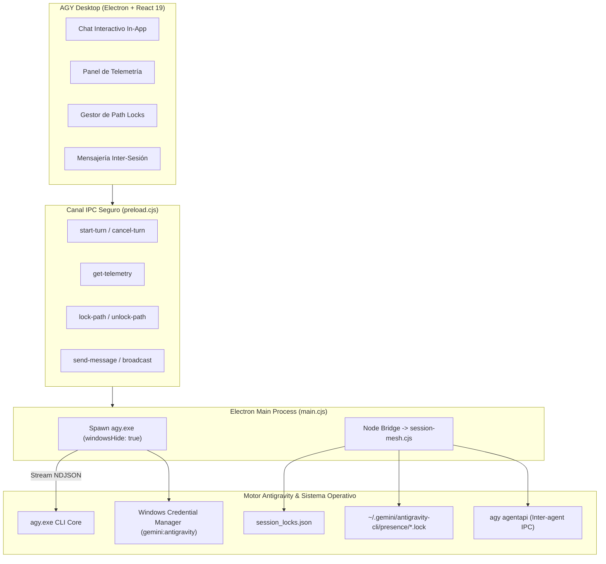

# 🛸 AGY Desktop — Antigravity Agent Control Plane

**AGY Desktop** es una aplicación de escritorio nativa para Windows (React 19 + Electron 34 + Tailwind CSS + Vite 6) diseñada como centro de control, orquestación y entorno interactivo para **Antigravity CLI**.

Permite interactuar con los agentes de Antigravity en tiempo real, visualizar telemetría multi-sesión, coordinar bloqueos de archivos (*path locks*) para prevenir colisiones entre agentes concurrentes y comunicarse entre sesiones, **todo directamente dentro de la interfaz gráfica sin abrir ventanas de terminal externas**.

---

## ✨ Características Principales

### 1. 💬 Agente Interactivo In-App (Sin Ventanas de Terminal)
- **Ejecución 100% Embebida:** Las instrucciones se procesan a través del motor headless de Antigravity (`agy.exe` con `--output-format stream-json`) en segundo plano sin desplegar ventanas de PowerShell o Windows Terminal (`windowsHide: true`).
- **Streaming de Tokens en Tiempo Real:** Visualización en vivo de los deltas de texto generados por el modelo a 60 fps.
- **Trazabilidad de Herramientas:** Indicadores visuales interactivos de cada herramienta ejecutada durante el turno (`read_file`, `edit_file`, `run_command`, etc.) con su estado (`ACTIVE`, `DONE`, parámetros).
- **Control de Turno:** Botón para cancelar o detener la ejecución en vivo en cualquier momento.
- **Selector de Modelos en Caliente:** Conmuta entre modelos disponibles (`gemini-3.8-flash-high`, `claude-sonnet-4-6`, etc.) directamente desde la cabecera.

### 2. 🔑 Cero Login Adicional (Zero-Auth)
- Hereda directamente las credenciales existentes de Windows Credential Manager (`gemini:antigravity`).
- Sin necesidad de configurar API keys o autenticaciones duplicadas.
- Comparte automáticamente tus configuraciones, workspaces, servidores MCP y plugins habilitados.

### 3. 🛡️ Coordinación Multi-Sesión & Path Locking (`session-mesh`)
- **Mission Control en Vivo:** Supervisa todas las sesiones de Antigravity CLI activas en la máquina local: ID de conversación, último prompt del usuario, herramientas activas y tareas asíncronas en progreso.
- **Detección Atómica de Presencia:** Detección en sub-milisegundos de sesiones vivas o terminadas mediante validación de descriptores de archivo Win32 (`~/.gemini/antigravity-cli/presence/*.lock`), purgando bloqueos huérfanos sin sobrecarga de sondeo.
- **Gestión Visual de Locks:** Bloquea directorios o archivos (`lock-path`) antes de realizar cambios estructurales y libéralos (`unlock-path`) al finalizar.
- **Protección Automática:** Se integra con el hook global `PreToolUse` de Antigravity, bloqueando intentos de edición concurrentes en rutas reservadas por otra sesión.

### 4. 📡 Tablón de Mensajería Inter-Agente (Mesh Chat)
- Envía mensajes reactivos directos (`send-message`) a otra sesión específica de la flota.
- Difunde avisos globales (*broadcast*) para alertar a todos los agentes en ejecución.

---

## 🏗️ Arquitectura del Sistema



---

## 📦 Instalación y Uso

### Prerrequisitos
- **Windows 10 / 11**
- **Node.js** >= 18
- **pnpm** >= 9 (`npm install -g pnpm`)
- **Antigravity CLI** instalado y autenticado en tu equipo (`agy`).

### 1. Clonar e Instalar Dependencias
```bash
git clone https://github.com/yogui-dev/agy-desktop.git
cd agy-desktop
pnpm install
```

### 2. Modo Desarrollo
```bash
# Iniciar servidor Vite + ventana Electron con recarga en caliente
pnpm dev
```

### 3. Compilar y Empaquetar
```bash
# Compilar frontend y empaquetar app.asar
pnpm build
```

### 4. Instalador para Windows (.exe)
Puedes generar el binario independiente o instalarlo en tu sistema con un solo clic:

- **Instalación local instantánea:** Ejecuta `install-agy-desktop.cmd` (o `install-agy-desktop.ps1`). Instala la aplicación en `%LOCALAPPDATA%\Programs\AGY Desktop` y crea accesos directos en el Escritorio y Menú Inicio.
- **Compilar paquete portátil:**
  ```bash
  pnpm dist:portable
  ```

---

## 🛠️ Estructura del Proyecto

```
agy-desktop/
├── electron/
│   ├── main.cjs            # Proceso principal: IPC handlers, runner headless de agy.exe
│   └── preload.cjs         # Context bridge seguro para React
├── src/
│   ├── App.jsx             # UI unificada: Chat In-App, Telemetría, Locks y Mesh
│   ├── main.jsx            # Entry point React 19
│   └── index.css           # Estilos Tailwind CSS
├── scripts/
│   └── pack-asar.cjs       # Empaquetado atómico de recursos en app.asar
├── public/
│   └── icon.ico            # Ícono nativo de la aplicación
├── install-agy-desktop.cmd  # Lanzador de instalación rápida para Windows
├── install-agy-desktop.ps1  # Script PowerShell de instalación y accesos directos
├── start-desktop.cmd       # Acceso rápido de ejecución local
└── package.json            # Configuración y scripts pnpm
```

---

## 🔒 Seguridad e Integración con `session-mesh`

El plugin global `session-mesh` (`~/.gemini/config/plugins/session-mesh`) actúa como el guardián de concurrencia:
- **Hook `PreToolUse`:** Intercepta cada llamada a `edit_file` o `write_file`. Si un archivo está bajo un lock activo de otra sesión viva, la operación es abortada automáticamente con un mensaje explicativo.
- **Hook `SessionStart`:** Al abrir cualquier nueva sesión de terminal o interfaz, notifica inmediatamente qué otras sesiones están operando y qué recursos tienen reservados.

---

## 📄 Licencia

MIT © [yogui-dev](https://github.com/yogui-dev)
