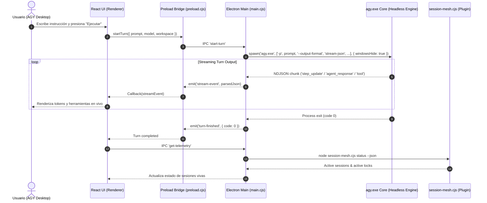

# 🏛️ AGY Desktop — Technical Architecture & Protocol Specification

This document details the internal design, inter-process communication (IPC) contracts, and synchronization mechanics that power **AGY Desktop** and the **Session Mesh** subsystem.

---

## 1. High-Level System Architecture

AGY Desktop coordinates multiple Antigravity sessions operating concurrently within the same operating system environment. It bridges the graphical desktop layer with Antigravity's CLI binary (`agy.exe`) and low-level Win32 presence locks.



---

## 2. In-App Headless Execution Protocol

To provide a fully embedded experience with **zero external terminal popups**, AGY Desktop executes `agy.exe` non-interactively using Antigravity's print streaming mode:

### Command Invocation
```powershell
agy.exe -p "<prompt>" `
  --output-format stream-json `
  --dangerously-skip-permissions `
  [--model "<model_id>"] `
  [--conversation "<conversation_id>"]
```

### Process Flags
- `windowsHide: true`: Completely suppresses Windows console window allocation (`CREATE_NO_WINDOW`).
- `cwd`: Configured to the user's workspace directory (`C:\Proyectos\yoguidev`).
- `env`: Inherits the active process environment (including `PATH`, `LOCALAPPDATA`, `USERPROFILE`).

### Streaming Events (NDJSON Format)
Output from `agy.exe` stdout is parsed line by line as NDJSON:

| Event Type | Key Fields | Description |
|---|---|---|
| `init` | `conversation_id`, `init.tools` | Emitted once upon initialization. Contains the session ID. |
| `step_update` | `step_type: "agent_response"`, `text_delta` | Emitted per token chunk for immediate UI rendering. |
| `step_update` | `step_type: "tool"`, `tool_name`, `state` | Emitted when tools (`read_file`, `edit_file`, etc.) execute. |
| `result` | `status: "SUCCESS"`, `response` | Emitted when the full turn completes. |

---

## 3. Zero-Auth Authentication Inheritance

AGY Desktop requires **no separate login screen**:
1. Antigravity stores encrypted access tokens inside the native **Windows Credential Manager** under the target `gemini:antigravity`.
2. When `agy.exe` is spawned as a child process of Electron, Windows provides ambient access to the current user's credential vault.
3. The child process authenticates natively, utilizing the user's authorized quotas, rate limits, and custom configurations stored in `%USERPROFILE%\.gemini\antigravity-cli\settings.json`.

---

## 4. Multi-Session Coordination & Path Locking (`session-mesh`)

When multiple agents run simultaneously (e.g., one agent generating code, another analyzing test coverage, and a third transcribing audio), they can step on each other's changes. The `session-mesh` plugin prevents this through cooperative path locks.

### Atomic Presence Detection (`isSessionAlive`)
Traditional polling or PID checking can be slow and brittle across Windows restarts. Antigravity maintains exclusive open file handles on lockfiles located at:
```
%USERPROFILE%\.gemini\antigravity-cli\presence\<conversationId>.lock
```
In Windows NTFS, an open file with exclusive access cannot be renamed. `session-mesh` performs an atomic test:
```javascript
function isSessionAlive(conversationId) {
  const lockFile = path.join(PRESENCE_DIR, `${conversationId}.lock`);
  if (!fs.existsSync(lockFile)) return false;
  try {
    fs.renameSync(lockFile, lockFile); // If alive, OS throws EBUSY or EPERM
    return false; // Renamed successfully -> session process died!
  } catch (err) {
    if (err.code === 'EBUSY' || err.code === 'EPERM') return true;
    return false;
  }
}
```
This check executes in **< 0.1ms** with zero CPU overhead, allowing automatic dead-lock pruning without false positives.

### Hook Enforcement (`PreToolUse`)
When any session attempts to call `edit_file` or `write_file`, the `PreToolUse` hook intercepts the path:
1. Compares the target path against active entries in `session_locks.json`.
2. If another *live* session holds the lock, the tool execution is rejected before filesystem mutation occurs.
3. If the lock owner has terminated, the dead lock is automatically purged.

---

## 5. Build & Packaging Pipeline

The application bundles both the compiled React 19 frontend and the Electron main process into an encrypted ASAR package:

1. **Vite Build (`pnpm build:ui`):** Compiles modern JSX and Tailwind CSS into static assets in `dist/`.
2. **ASAR Packaging (`scripts/pack-asar.cjs`):** Assembles `dist/`, `electron/`, `public/`, and `package.json` into `app.asar` using `@electron/asar`.
3. **Live Sync:** Automatically updates both `release/win-unpacked/resources/app.asar` and the installed application in `%LOCALAPPDATA%\Programs\AGY Desktop\resources\app.asar`.
